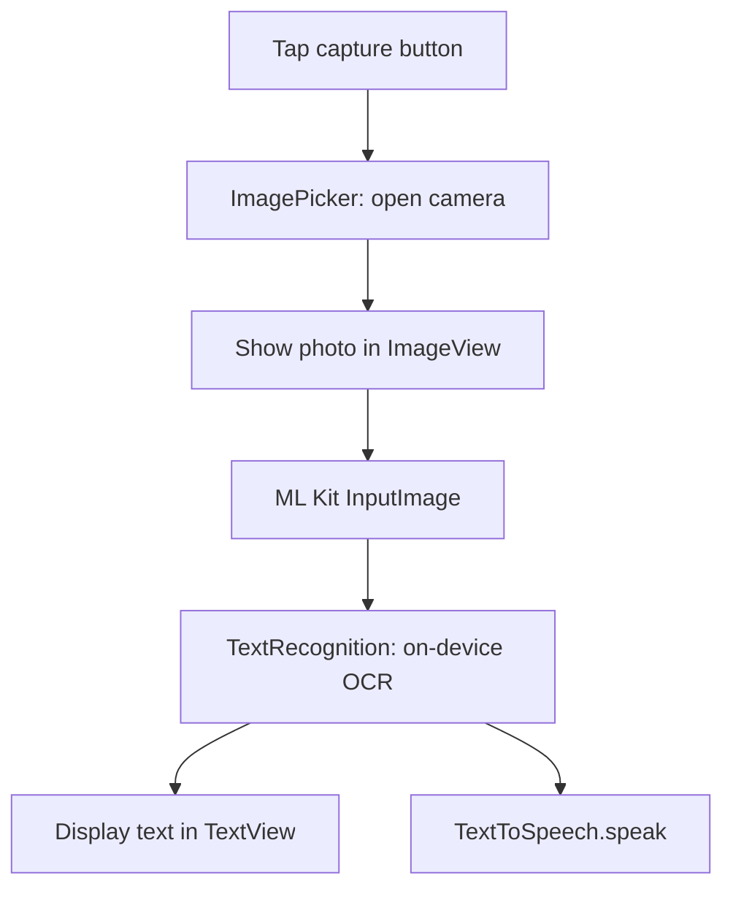

# TextRecognization

Android app that extracts text from a photo and reads it aloud — the same camera-OCR-TTS idea as [Reader-For-Blind](https://github.com/rg-incognito/Reader-For-Blind), here with an explicit button-triggered capture flow and an image preview.

## How it works

Tapping the capture button opens the camera via `ImagePicker.cameraOnly()`. The resulting photo is shown in an `ImageView` and converted to an ML Kit `InputImage`, which `TextRecognition`'s on-device recognizer processes. The recognized text is displayed in a `TextView` and spoken aloud via Android's `TextToSpeech`.

## Architecture

| File | Role |
|---|---|
| `MainActivity.java` | Capture button, image preview, ML Kit OCR, text-to-speech output |

## Tech stack

Java · Android · Google ML Kit (Text Recognition) · Android `TextToSpeech` · ImagePicker

## Setup

Open in Android Studio and run on a device with a camera.
